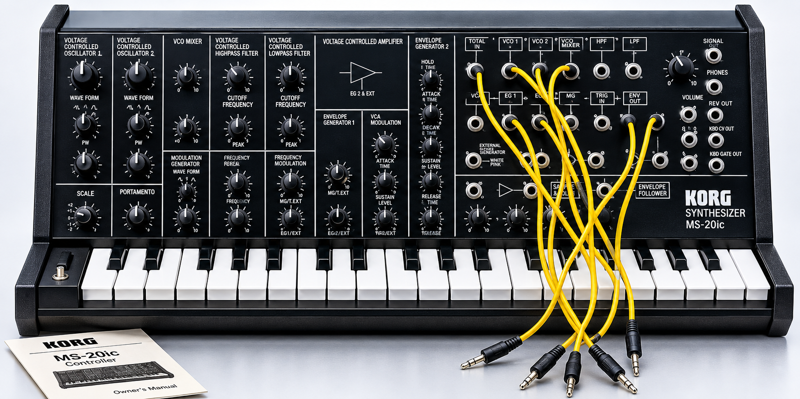
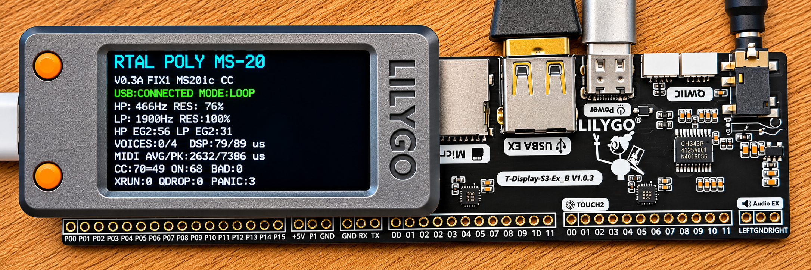
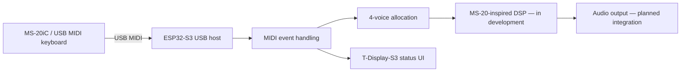

# RTAL POLY MS-20
### Bringing an Analog Legend into the Digital World

**An independent ESP32-S3 synthesizer project inspired by the iconic KORG MS-20.**

  

**Vintage character. Modern embedded hardware. Polyphonic ambitions.**

---

## The idea

What if the unmistakable hands-on experience of an MS-20-style synthesizer could meet a modern, compact, standalone digital sound engine — without needing a PC to run the synthesis?

**RTAL POLY MS-20** is our ongoing experiment in bringing classic semi-modular synthesis concepts to the **LILYGO T-Display-S3 + MIDI Expansion Board V1.0.3**, powered by an ESP32-S3.

Our goal is not just to reproduce a vintage front panel: we want to explore **MS-20-inspired oscillators, aggressive high-pass/low-pass filtering, modulation, and polyphonic playing** on affordable embedded hardware.

> **This is a development teaser, not a finished instrument or a claim of circuit-accurate emulation.** Features described as planned are not yet hardware-validated.

## The inspiration: KORG MS-20iC

*Reference photograph: KORG MS-20iC USB controller, originally created for the KORG Legacy Collection. Image: Sound On Sound (external link; copyright remains with its owner).*

The **MS-20iC** is a dedicated USB-MIDI controller with a keyboard, knobs and a patch panel — **not an analog sound-generating MS-20**. That distinction is central to our project: the embedded board is intended to generate the audio, while external MIDI controllers provide hands-on control.

## Our hardware platform

*LILYGO T-Display-S3 and MIDI expansion hardware. Image: LILYGO (external product photograph).*

- **ESP32-S3** microcontroller with dual-core processing
- **T-Display-S3** color display for live status and synth UI
- **MIDI Expansion Board V1.0.3** with USB host connectivity, audio hardware and expansion options
- **USB-MIDI host** for connecting external keyboards and controllers
- **Standalone DSP** as the long-term goal

## What we're building

### The synthesis concept

| Building block | Development direction |
|---|---|
| Dual oscillators | Classic analog-style waveforms and oscillator interaction |
| HPF + LPF | Characterful, resonant MS-20-inspired filtering |
| Envelopes | Expressive amplitude and filter modulation |
| Modulation | LFO and semi-modular routing concepts |
| Polyphony | Four-voice architecture as an initial target |
| Hardware control | USB-MIDI keyboards, including investigation of MS-20iC control mapping |
| Interface | Compact display with live MIDI and synth diagnostics |

*These are project goals, not a list of completed DSP features.*

## Development progress

**Already confirmed in hardware testing:**

- [x] ESP32-S3 USB-MIDI host enumeration and connection
- [x] Live MIDI monitor on the T-Display-S3
- [x] AKAI LPK25 keyboard input
- [x] KORG MS-20 mini USB-MIDI note input
- [x] Note On / Note Off handling
- [x] Four-voice MIDI allocation and voice release
- [x] Stable boot tests without spontaneous ghost notes in the validated diagnostic build

**Next steps / work in progress:**

- [ ] Validate the full MS-20iC USB-MIDI controller mapping
- [ ] Develop and evaluate MS-20-inspired oscillator and filter DSP
- [ ] Integrate and validate the complete audio signal path
- [ ] Build a practical synthesizer UI and parameter controls
- [ ] Measure real-time DSP performance and audio stability
- [ ] Expand the sound design and modulation architecture

### A small board. A big synthesizer challenge.

The real challenge is to combine **low-latency USB MIDI, responsive display updates, polyphonic voice handling and expressive real-time audio DSP** on a compact microcontroller platform.

Our development approach is iterative: **implement → flash → measure → listen → improve**.

## Follow the build

This repository will document experiments, firmware milestones, hardware testing, performance measurements and — when ready — sound demos.

**More to come. Stay tuned.**

---

RTAL POLY MS-20 is an independent experimental project, not affiliated with or endorsed by KORG or LILYGO. KORG, MS-20 and other product names are trademarks of their respective owners. External reference photos are shown for identification and inspiration; replace them with original, permission-cleared photographs for a fully self-contained public release.
